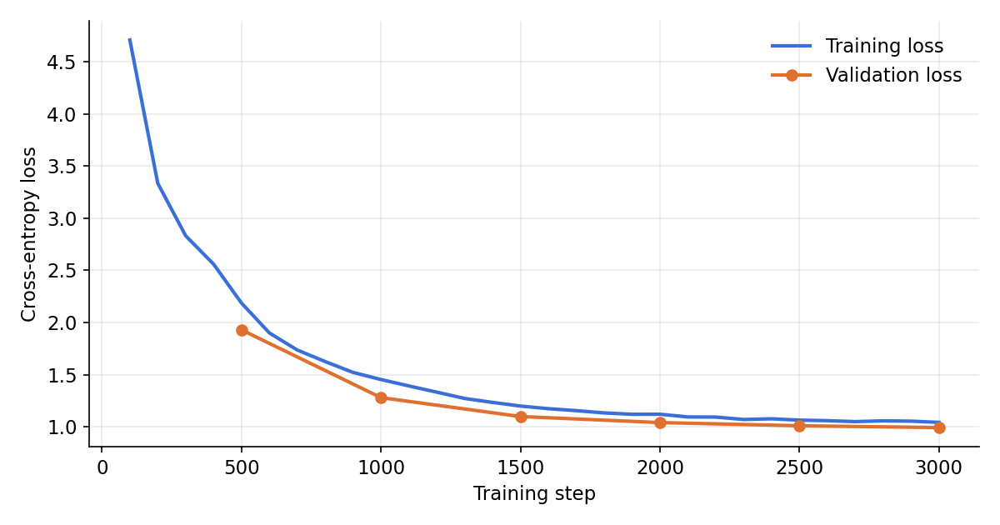
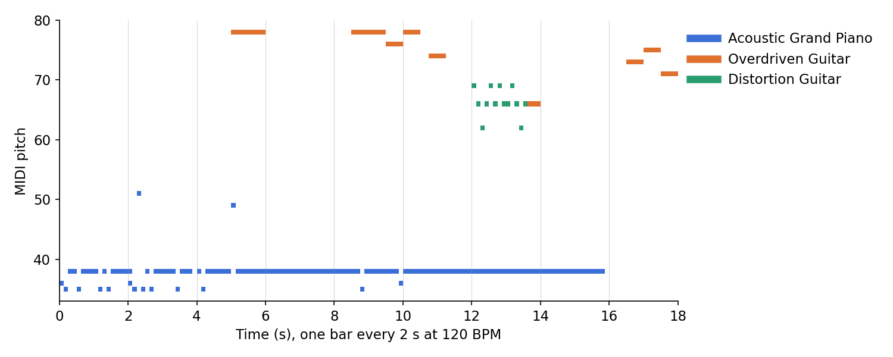

# Music Generation with GPT-2

[](https://colab.research.google.com/github/abinaya25138/midi-music-generation-gpt2/blob/main/music_generation.ipynb)

A GPT-2 language model trained from scratch to compose multi-track MIDI music. MIDI files are cut into 8-bar pieces and written out as text, and the model learns to continue that text one musical event at a time. While it trains, it composes a new piece at every evaluation and plays it back, so you can hear it go from noise to music.

I built this pipeline during my internship at Intel to generate Indian classical music, training it on a MIDI dataset we built by hand from recordings. That dataset isn't included here. The example run below uses public MIDI files to show the code working end to end.

## How it works

1. **Cut into pieces.** Every MIDI file is split into 8-bar chunks (4/4). Notes go to the chunk they start in, with times shifted so each chunk starts at zero. Chunks with fewer than 10 notes are dropped.
2. **Write as text.** Each chunk is encoded in the MMM (Multi-Track Music Machine) token format. Tracks come one after another, each made of bars, each bar a list of note events:

   ```
   PIECE_START TRACK_START INST=0 DENSITY=2
     BAR_START NOTE_ON=60 TIME_DELTA=4 NOTE_OFF=60 TIME_DELTA=2 NOTE_ON=64 ... BAR_END
     ...
   TRACK_END TRACK_START INST=33 ... TRACK_END PIECE_END
   ```

   `INST` is the General MIDI instrument, and `TIME_DELTA` moves time forward in sixteenth notes. Snapping every file to the same sixteenth-note grid keeps the vocabulary small, whatever each file's original timing resolution.
3. **Tokenizer.** GPT-2's English tokenizer would break `NOTE_ON=60` into fragments, so a word-level tokenizer is trained instead: every distinct MMM token is one vocabulary entry. It splits on spaces only. Splitting on `=` as well would make the generated text impossible to decode back into notes.
4. **Model.** GPT-2 with 6 layers, 8 attention heads and 512-dimensional embeddings, trained from random weights on next-token prediction with a 512-token context.
5. **Back to music.** A decoder turns generated tokens into a `NoteSequence`, restarting the clock at each track and snapping to bar lines, and closes any notes the model left open. It's rendered to audio with FluidSynth and saved as `.wav` and `.mid`.

## Example run

To show the code working, I trained the notebook's pipeline on 3,000 songs from the public [Lakh MIDI Dataset](https://colinraffel.com/projects/lmd/) (Clean MIDI subset) on an Apple M4 laptop.

| | |
|---|---|
| Training pieces | 40,983 eight-bar pieces (36,884 for training, 1,000 held out for validation) |
| Vocabulary | 434 tokens |
| Model | GPT-2, 6 layers, 8 heads, 512-dim embeddings, 19.4M parameters, randomly initialized |
| Training | 3,000 steps, batch size 16 (about 1.3 epochs) |



Validation loss fell from 1.93 to 0.99 over 3,000 steps and stayed below the training loss throughout, so the model is generalizing to pieces it hasn't seen rather than memorizing.



A piece the model composed from the prompt `PIECE_START TRACK_START`: a bass line with guitar phrases on top, across three instruments. At this stage the output has a steady pulse and plausible instrument parts, but it is repetitive; longer training would be the next step.

Generated samples are in [`results/samples/`](results/samples). Open them in GarageBand or any MIDI player. `early_step_500.mid` is from early in training, for comparison.

## Run it

1. Download MIDI files to train on, for example the [Lakh MIDI Dataset](https://colinraffel.com/projects/lmd/) (the Clean MIDI subset is a good size to start with), and upload the folder to Google Drive.
2. Open the notebook in Colab with the badge above and choose a GPU runtime.
3. Set `MIDI_DIR` in the settings cell to that Drive folder, then run all cells.

Optional:

- **Weights & Biases logging.** Add your API key as a Colab secret named `WANDB_API_KEY`.
- **Publish the dataset and tokenizer to the Hugging Face Hub.** Set `HF_USERNAME`.

Everything the notebook produces is saved to `MyDrive/music_gpt2/`:

| Path | What it is |
| --- | --- |
| `pieces.txt` | The tokenized dataset, one 8-bar piece per line |
| `tokenizer/` | The trained word-level tokenizer |
| `checkpoints/`, `model/` | Training checkpoints and the final model |
| `generated/` | Pieces composed during and after training, as `.wav` and `.mid` |

## Limitations

- Each track is treated as one note at a time, so chords inside a track are spread out into short runs of notes.
- Pieces are assumed to be in 4/4 and are played back at 120 BPM, because the tokens don't record tempo.
- Drum tracks aren't marked separately, so they play back on a melodic instrument.
- Busy multi-track pieces longer than 512 tokens are truncated, which drops their last tracks.

## Tech stack

PyTorch, Hugging Face Transformers, Tokenizers and Datasets, miditoolkit, note_seq, FluidSynth, Weights & Biases (optional)
